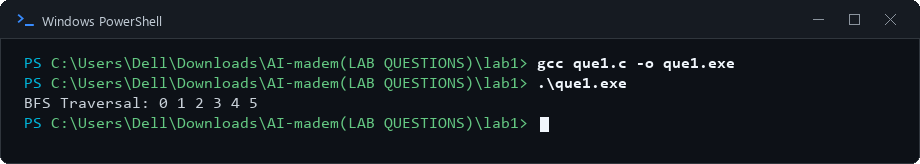
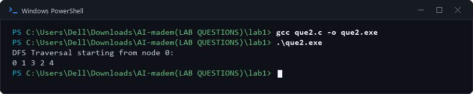
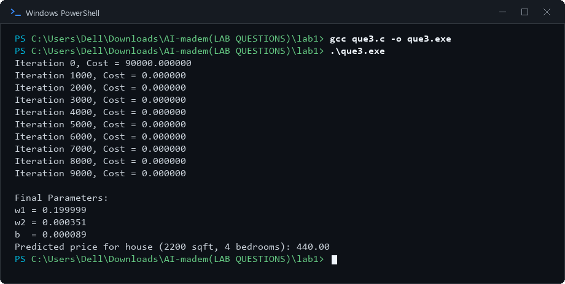

# Lab 1: Graph Traversal and Linear Regression

## 1. Aim
To implement Breadth-First Search (BFS), Depth-First Search (DFS), and Linear Regression.

## 2. Objectives
- Understand graph representation using an adjacency matrix.
- Traverse a graph using BFS and DFS.
- Implement linear regression using gradient descent to predict a continuous value.

## 3. Algorithm / Steps

### Experiment 1: Breadth-First Search (BFS)
1. Represent the graph using an adjacency matrix.
2. Add the starting vertex to a queue and mark it as visited.
3. Remove the front vertex from the queue and print it.
4. Add each unvisited adjacent vertex to the queue and mark it as visited.
5. Repeat until the queue is empty.

### Experiment 2: Depth-First Search (DFS)
1. Represent the graph using an adjacency matrix.
2. Start from the selected vertex and mark it as visited.
3. Print the current vertex.
4. Recursively visit each adjacent vertex that has not been visited.
5. Stop when all reachable vertices have been visited.

### Experiment 3: Linear Regression Using Gradient Descent
1. Initialize the weights and bias to zero.
2. Calculate predictions using the input features, weights, and bias.
3. Calculate prediction errors and the mean squared error cost.
4. Compute gradients for the weights and bias.
5. Update the parameters using the learning rate.
6. Repeat for the specified number of iterations and predict the value for the test input.

## 4. Source Code
- `que1.c` — Breadth-First Search (BFS)
- `que2.c` — Depth-First Search (DFS)
- `que3.c` — Linear Regression

## 5. Output Screenshots

### Experiment 1: Breadth-First Search (BFS)

### Experiment 2: Depth-First Search (DFS)

### Experiment 3: Linear Regression Using Gradient Descent

## 6. Result and Conclusion
BFS and DFS were implemented to traverse a graph using different traversal strategies. Linear regression was implemented using gradient descent to learn model parameters and predict a continuous value.

## 7. Group Members

| S. No. | Name | Enrollment Number |
|---:|---|---|
| 1 | Tej Pratap Singh | 2024BITE078 |
| 2 | Gopi Kishan Sahu | 2024BITE034 |
| 3 | Prateek Kumar Singh | 2024BITE010 |
| 4 | Bandi Kumar | 2024BITE042 |
| 5 | Mohit Moriya | 2024BITE024 |
