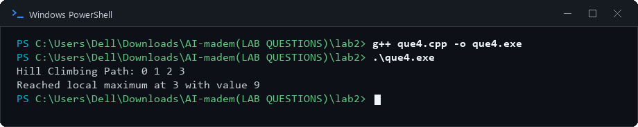

# Lab 2: Informed Search and Local Search Algorithms

## 1. Aim
To implement Best-First Search, A* Search, AO* Search, and Hill Climbing.

## 2. Objectives
- Understand heuristic-based search techniques.
- Learn how Best-First Search selects nodes using heuristic values.
- Understand how A* combines path cost and heuristic estimates.
- Explore AND/OR graph traversal using AO*.
- Use Hill Climbing to improve a solution based on a heuristic.

## 3. Algorithm / Steps

### Experiment 1: Best-First Search
1. Insert the start node into a priority queue according to its heuristic value.
2. Remove the node with the smallest heuristic value.
3. If it has not been visited, mark it as visited and print it.
4. If it is the goal node, stop the search.
5. Add its unvisited neighbouring nodes to the priority queue.
6. Repeat until the goal is found or no nodes remain.

### Experiment 2: A* Search
1. Set the start node's path cost `g` to zero.
2. Calculate `f(n) = g(n) + h(n)`, where `g(n)` is the cost from the start and `h(n)` is the heuristic estimate to the goal.
3. Select the frontier node with the smallest `f(n)` value.
4. Examine its neighbours and update their path costs when a lower-cost route is found.
5. Repeat until the goal is reached or no nodes remain.

### Experiment 3: AO* Search
1. Represent the problem as an AND/OR graph with a root node and child groups.
2. Begin at the root node.
3. Select a child or child group according to the implementation.
4. Explore the selected children recursively.
5. Display the selected solution traversal.

Note: If the supplied program selects the first child group without comparing costs, describe it as a simplified AO* demonstration rather than a complete cost-optimising AO* implementation.

### Experiment 4: Hill Climbing
1. Start from the initial state.
2. Evaluate the current state and its neighbouring states.
3. Select a neighbour with a better heuristic value.
4. Move to that neighbour and repeat the evaluation.
5. Stop when no neighbour improves the current value.
6. Report the final state reached.

## 4. Source Code
- `que1.cpp` — Best-First Search
- `que2.cpp` — A* Search
- `que3.cpp` — AO* Search
- `que4.cpp` — Hill Climbing

## 5. Output Screenshots

### Experiment 1: Best-First Search

### Experiment 2: A* Search

### Experiment 3: AO* Search

### Experiment 4: Hill Climbing

## 6. Result and Conclusion
Best-First Search, A* Search, AO* Search, and Hill Climbing were explored as AI search techniques. The experiments demonstrate heuristic-guided exploration, path-cost evaluation, AND/OR graph traversal, and local optimisation.

## 7. Group Members

| S. No. | Name | Enrollment Number |
|---:|---|---|
| 1 | Tej Pratap Singh | 2024BITE078 |
| 2 | Gopi Kishan Sahu | 2024BITE034 |
| 3 | Prateek Kumar Singh | 2024BITE010 |
| 4 | Bandi Kumar | 2024BITE042 |
| 5 | Mohit Moriya | 2024BITE024 |
