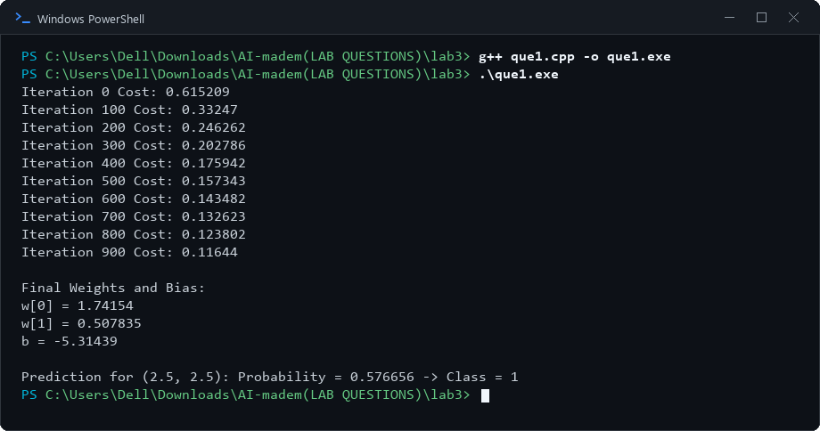

# Lab 3: Logistic Regression Using Gradient Descent

## 1. Aim
To implement logistic regression using gradient descent for binary classification.

## 2. Objectives
- Understand the sigmoid activation function used in logistic regression.
- Train model weights and bias using gradient descent.
- Calculate the binary cross-entropy (log-loss) cost.
- Predict the class of a sample using its estimated probability.

## 3. Algorithm / Steps
1. Prepare the feature matrix and binary target labels.
2. Initialize the model weights and bias to zero.
3. Calculate the linear score for each sample: `z = b + w1*x1 + w2*x2 + ...`.
4. Apply the sigmoid function: `sigmoid(z) = 1 / (1 + exp(-z))`.
5. Compare predicted probabilities with the actual labels and calculate the gradients.
6. Update the weights and bias using the learning rate.
7. Repeat the training process for the specified number of iterations.
8. Display the cost at the required intervals and print the final weights and bias.
9. Use the trained model to estimate the probability for a test sample.
10. Apply the chosen threshold (commonly 0.5) to predict the binary class.

## 4. Source Code
- `que1.cpp` — Logistic Regression using Gradient Descent

## 5. Output Screenshots

### Logistic Regression Using Gradient Descent

## 6. Result and Conclusion
Logistic regression was implemented using gradient descent. The model learned its parameters from the training data and used the resulting probability to classify a test sample into one of two classes.

## 7. Group Members

| S. No. | Name | Enrollment Number |
|---:|---|---|
| 1 | Tej Pratap Singh | 2024BITE078 |
| 2 | Gopi Kishan Sahu | 2024BITE034 |
| 3 | Prateek Kumar Singh | 2024BITE010 |
| 4 | Bandi Kumar | 2024BITE042 |
| 5 | Mohit Moriya | 2024BITE024 |
