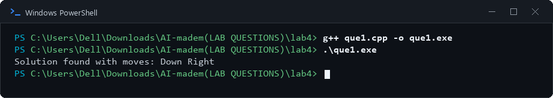
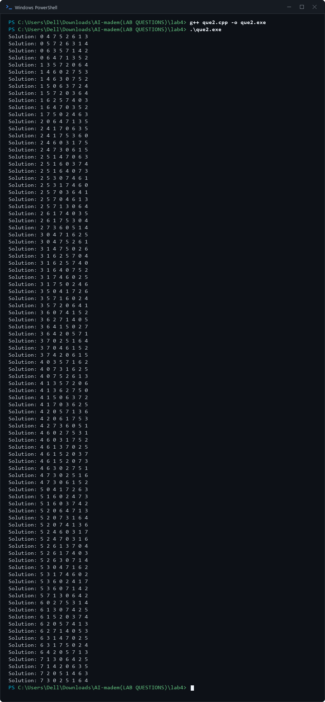
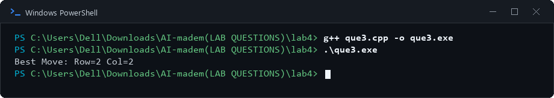

# Lab 4: AI Problem Solving Using Search Algorithms

## 1. Aim
To implement Breadth-First Search for the 8-Puzzle, backtracking for the 8-Queens problem, and Minimax for Tic-Tac-Toe.

## 2. Objectives
- Understand state-space search using the 8-Puzzle problem.
- Solve the 8-Queens constraint-satisfaction problem using backtracking.
- Understand game-tree search and decision-making using Minimax.
- Apply different AI techniques to different problem types.

## 3. Algorithm / Steps

### Experiment 1: 8-Puzzle Using Breadth-First Search (BFS)
1. Represent the puzzle as a 3 × 3 board, using `0` for the blank tile.
2. Store the initial state in a queue and mark it as visited.
3. Remove the front state from the queue.
4. If the state matches the goal configuration, stop.
5. Generate valid neighbouring states by moving the blank tile up, down, left, or right.
6. Add each unseen valid state to the queue and mark it as visited.
7. Continue until the goal is found or the queue becomes empty.

### Experiment 2: 8-Queens Using Backtracking
1. Represent the chessboard as an 8 × 8 board.
2. Place one queen in each column.
3. Before placing a queen, check that its row and both diagonals are not occupied by an earlier queen.
4. If the position is safe, place the queen and move to the next column.
5. If no safe row exists, backtrack to the previous column and try another position.
6. When all eight queens are placed safely, display the solution.

### Experiment 3: Tic-Tac-Toe Using Minimax
1. Represent the board as a 3 × 3 grid.
2. Check whether the current board is a win, loss, or draw.
3. Assign a score to terminal states.
4. Recursively explore each available move, alternating between the maximizing and minimizing players.
5. Undo each trial move after evaluating it.
6. Compare the scores of the available moves.
7. Select the move with the highest score for the maximizing player and display the resulting board.

## 4. Source Code
- `que1.cpp` — 8-Puzzle using BFS
- `que2.cpp` — 8-Queens using Backtracking
- `que3.cpp` — Tic-Tac-Toe using Minimax

## 5. Output Screenshots

### Experiment 1: 8-Puzzle Using Breadth-First Search (BFS)

### Experiment 2: 8-Queens Using Backtracking

### Experiment 3: Tic-Tac-Toe Using Minimax

## 6. Result and Conclusion
BFS, backtracking, and Minimax were applied to three classic AI problems. The experiments demonstrate state-space exploration, constraint satisfaction, and adversarial decision-making.

## 7. Group Members

| S. No. | Name | Enrollment Number |
|---:|---|---|
| 1 | Tej Pratap Singh | 2024BITE078 |
| 2 | Gopi Kishan Sahu | 2024BITE034 |
| 3 | Prateek Kumar Singh | 2024BITE010 |
| 4 | Bandi Kumar | 2024BITE042 |
| 5 | Mohit Moriya | 2024BITE024 |
