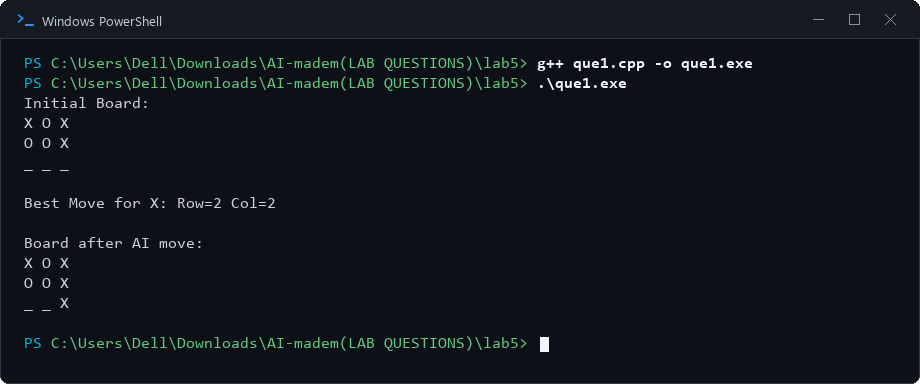

# Lab 5: Minimax Algorithm for Game Playing

## 1. Aim
To implement the Minimax algorithm to choose a strong move in Tic-Tac-Toe.

## 2. Objectives
- Represent the Tic-Tac-Toe board and identify terminal states.
- Evaluate wins, losses, and draws using a scoring function.
- Explore possible future moves recursively.
- Select the best move for the maximizing player.

## 3. Algorithm / Steps
1. Initialize and display the Tic-Tac-Toe board.
2. Check whether the current board represents a win, loss, or draw.
3. If the state is terminal, return its score.
4. On the maximizing player's turn, select the maximum score among available moves.
5. On the minimizing player's turn, select the minimum score among available moves.
6. Undo each trial move after evaluating it.
7. Evaluate the legal moves for the AI player and select the move with the highest Minimax score.
8. Apply the selected move and display the resulting board.

## 4. Source Code
- `que1.cpp` — Minimax algorithm for Tic-Tac-Toe

## 5. Output Screenshots

### Minimax Algorithm for Tic-Tac-Toe

## 6. Result and Conclusion
The Minimax algorithm was implemented to evaluate possible Tic-Tac-Toe moves and select a move that gives the best outcome assuming both players play optimally.

## 7. Group Members

| S. No. | Name | Enrollment Number |
|---:|---|---|
| 1 | Tej Pratap Singh | 2024BITE078 |
| 2 | Gopi Kishan Sahu | 2024BITE034 |
| 3 | Prateek Kumar Singh | 2024BITE010 |
| 4 | Bandi Kumar | 2024BITE042 |
| 5 | Mohit Moriya | 2024BITE024 |
