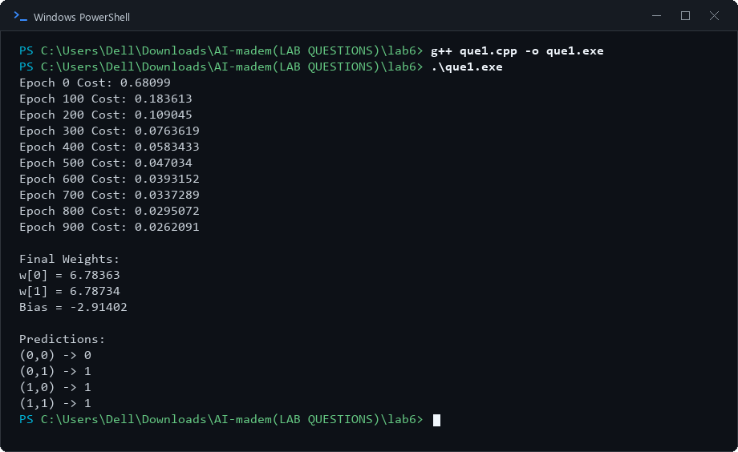

# Lab 6: Single-Layer Neural Network for Classification

## 1. Aim
To implement a single-layer neural network using a sigmoid activation function for binary classification.

## 2. Objectives
- Understand weights, bias, and the sigmoid activation function.
- Train model parameters using gradient descent.
- Classify inputs into class 0 or class 1.
- Test the model on the OR truth table.

## 3. Algorithm / Steps
1. Prepare the OR dataset with two input features and binary labels.
2. Initialize weights and bias and set the learning rate.
3. For each training example, calculate the weighted sum plus bias.
4. Apply the sigmoid function to obtain a predicted probability.
5. Calculate the prediction error and update the weights and bias.
6. Repeat the training process for the specified number of epochs.
7. Display the training cost and final parameters if provided by the program.
8. Predict and print the class for each input pair using the program's threshold, commonly 0.5.

## 4. Source Code
- `que1.cpp` — Single-layer sigmoid neural network trained using gradient descent

## 5. Output Screenshots

### Single-Layer Neural Network (Perceptron) for Binary Classification

## 6. Result and Conclusion
A single-layer neural network was trained on the OR truth table. The model learned parameters and produced binary predictions for the input examples.

## 7. Group Members

| S. No. | Name | Enrollment Number |
|---:|---|---|
| 1 | Tej Pratap Singh | 2024BITE078 |
| 2 | Gopi Kishan Sahu | 2024BITE034 |
| 3 | Prateek Kumar Singh | 2024BITE010 |
| 4 | Bandi Kumar | 2024BITE042 |
| 5 | Mohit Moriya | 2024BITE024 |
