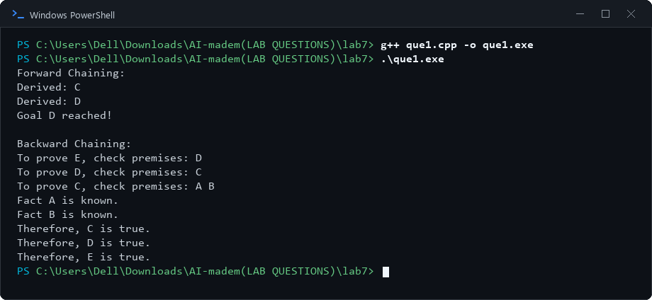

# Lab 7: Forward Chaining and Backward Chaining

## 1. Aim
To implement forward chaining and backward chaining for rule-based inference.

## 2. Objectives
- Represent knowledge using facts and IF-premise-THEN-conclusion rules.
- Derive new facts using forward chaining.
- Prove a goal by working backward from its conclusion using backward chaining.
- Compare data-driven and goal-driven inference.

## 3. Algorithm / Steps

### Experiment 1: Forward Chaining
1. Start with the known facts and a list of rules.
2. Check whether all premises of each rule are present in the facts.
3. If a rule's premises are satisfied, add its conclusion as a new fact.
4. Repeat until the goal is derived or no new facts can be added.

### Experiment 2: Backward Chaining
1. Begin with the goal to be proved.
2. If the goal is already a known fact, return success.
3. Find a rule whose conclusion matches the goal.
4. Recursively attempt to prove each premise of that rule.
5. If all premises can be proved, report that the goal is proved; otherwise report failure.

## 4. Source Code
- `que1.cpp` — Forward Chaining and Backward Chaining

## 5. Output Screenshots

### Forward Chaining and Backward Chaining

## 6. Result and Conclusion
Forward chaining and backward chaining were implemented for a small rule base. Forward chaining derives conclusions from known facts, while backward chaining attempts to prove a specified goal using facts and rules.

## 7. Group Members

| S. No. | Name | Enrollment Number |
|---:|---|---|
| 1 | Tej Pratap Singh | 2024BITE078 |
| 2 | Gopi Kishan Sahu | 2024BITE034 |
| 3 | Prateek Kumar Singh | 2024BITE010 |
| 4 | Bandi Kumar | 2024BITE042 |
| 5 | Mohit Moriya | 2024BITE024 |
